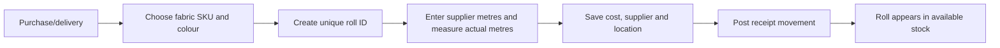
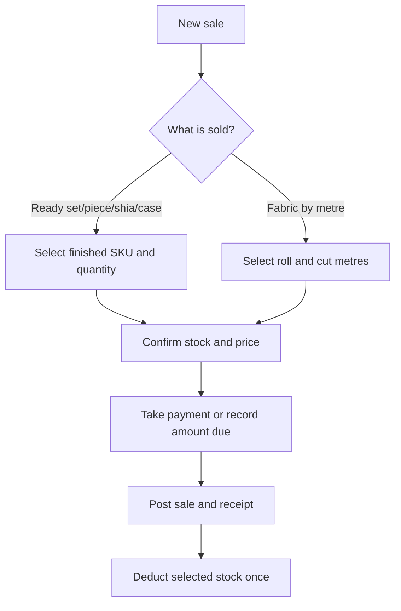

# 02 — Workflows

## 1. Receive a roll



The screen should accept multiple rolls on one supplier delivery. Select or create the correct category, material type, texture, design and colour before posting. A quantity discrepancy is visible at receipt, never hidden by replacing the supplier number. Print or write the roll ID on a tag. The receiving event records the signed-in staff member.

## 2. Custom curtain order and sewing

```mermaid
flowchart LR
  A[Quote: measurements and chosen items] --> B[Set, single piece, shia, cases or combination]
  B --> C[Reserve each chosen material from a specific roll]
  C --> D[Take deposit if required]
  D --> E[Issue cutting job]
  E --> F[Record actual cut and offcut/waste]
  F --> G[Sew and inspect]
  G --> H[Create only the finished outputs ordered]
  H --> I[Collect balance]
  I --> J[Hand over and close order]
```



Most customers bring their own house measurements. Record each window/opening separately: width, drop, fullness, number of curtain pieces, heading type, lining and seam allowance as applicable. Add shia as an optional separate line or as a chosen component of a set. A customer can buy a single curtain piece with no shia, or shia alone. The system can suggest required metres from a configurable formula, but the cutter confirms the actual cut. A job can use several rolls and trims. The assigned cutter and tailor are shown, while the **actual signed-in person** is captured on each cut, sewing completion and inspection. A partly completed order remains visible in work in progress.

### Staff accountability example

1. Manager assigns job `PJ-208` to Amina for sewing. Amina signs in with her own account.
2. Amina records separate sewing entries against that job: **7.600 m** of cream woven linen for the curtain pieces and **4.700 m** of ivory light-weave shia fabric. The job and rolls provide those material details automatically. After inspection, the ordered set is marked complete.
3. The dashboard immediately shows **12.300 m fabric sewn** and **1 set completed** for Amina, with a link to `PJ-208`. If another worker finishes **7.700 m** later, the team total shows **20.000 m** and each person's contribution remains visible. If one worker alone reaches 20 m, that person's row shows 20 m.
4. A manager's correction creates a reversal or adjustment with reason and approver, so the original worker entry remains traceable.

## 3. Sell ready stock or fabric



Post the sale and its stock deduction in one database transaction. A set reduces set stock; a single piece reduces piece stock; shia alone reduces shia stock. For an assembled set, its internal pieces are not also counted as independent sellable stock. If payment remains pending, show a clear outstanding balance. Returns are separate reverse movements linked to the original sale; damaged goods go to a non-sellable location.

## 4. M-Pesa Paybill flow

```mermaid
sequenceDiagram
  participant Staff
  participant System
  participant Daraja as Safaricom Daraja
  participant Customer
  Staff->>System: Open order, enter amount and customer phone
  System->>Daraja: STK Push request with Paybill and short order reference
  Daraja-->>System: Request accepted and CheckoutRequestID
  Daraja->>Customer: M-Pesa PIN prompt
  Customer->>Daraja: Approve or cancel
  Daraja-->>System: Final callback
  System->>System: Verify reference, amount, receipt; record payment once
  System-->>Staff: Paid, failed, or pending/review
```

**STK Push:** use M-PESA Express with `CustomerPayBillOnline`, the business Paybill shortcode and an order reference. Safaricom returns an initial acknowledgement and later a callback; only the successful callback (or independently verified transaction) should settle the payment. Store `MerchantRequestID`, `CheckoutRequestID`, final result and M-Pesa receipt. The official [M-PESA Express documentation](https://developer.safaricom.co.ke/apis/MpesaExpressSimulate) describes the asynchronous flow and production prerequisites.

**Customer pays manually:** the customer enters the Paybill and order reference in their M-Pesa app/USSD. C2B confirmation posts the transaction to the system. Match by exact reference first, then amount and context. A missing/ambiguous reference goes into an **unmatched payments** queue for a manager. Do not infer a customer only from phone: Safaricom's C2B payload can mask the number. The [C2B documentation](https://developer.safaricom.co.ke/apis/CustomerToBusiness) covers confirmation and optional validation callbacks.

**Reconciliation:** callbacks may be late, duplicated or missed. Make receipt/transaction ID unique, process callbacks idempotently, and show unresolved payments for daily comparison with the M-Pesa organization statement. Where possible, use Safaricom's [Transaction Status API](https://developer.safaricom.co.ke/apis/TransactionStatus) or available portal records to investigate a missing callback. A timeout remains “pending verification”, never “failed and safe to retry” without checking.

**Security:** credentials and passkey stay on the server. Use HTTPS public callback endpoints; authenticate staff; restrict who can issue refunds or manually confirm payments. Treat inbound callbacks as untrusted until reconciled against a known request/shortcode/amount; keep raw provider event IDs and audit records without exposing sensitive values in the UI.

## 5. Daily close

1. Cashier reviews sales, cash and M-Pesa receipts for the day.
2. Manager resolves unmatched payments and stock exceptions.
3. Compare M-Pesa transaction list with the business portal/statement; record differences for investigation.
4. Export daily sales and stock movement summary; automated backup runs separately.
