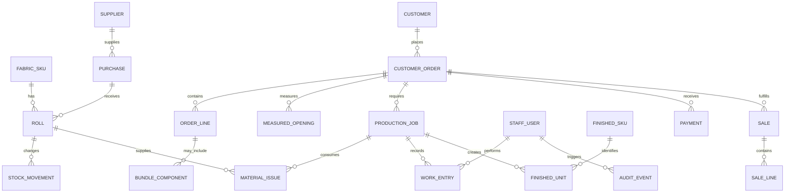

# 03 — Data model and stock arithmetic

## Relationship sketch

## Records and essential fields

| Record | Essential fields |
|---|---|
| `fabric_skus` | ID, category, material type ID, texture/finish ID, design/code, colour ID, pattern, width cm, unit, reorder threshold, active |
| `rolls` | ID/tag, fabric SKU ID, purchase ID, supplier stated metres, measured received metres, cost KES, location, status |
| `stock_movements` | ID, item type/ID, source/destination location, quantity, unit, movement type, related document, actor, timestamp, reversal link |
| `remnants` | ID, origin roll, length and width, colour/design, condition, location, status |
| `finished_skus` | ID, category (set, curtain piece, shia, pillow case), design, colour, standard size if stocked, style, unit, retail price, active |
| `finished_units` | ID, finished SKU, order/job link, quantity, location, quality status, cost snapshot |
| `customers` | ID, name, phone, optional delivery address, notes with restricted access |
| `customer_orders` | ID, customer, status, created/due dates, deposit policy, total KES, paid KES derived, balance derived |
| `measured_openings` | ID, order, room/window label, customer width/drop, agreed finished width/drop, measurement unit, notes |
| `order_lines` | ID, order, opening if relevant, sale type (set, piece, shia, fabric metres, case), quantity, unit, style, unit price, discount, tax setting |
| `bundle_components` | ID, set order line, required finished item (curtain piece or shia), quantity and measurement link; shia rows exist only if selected |
| `staff_users` | ID, unique username/phone, display name, password hash, active status, role assignments, last sign-in; never store plaintext passwords |
| `production_jobs` | ID, order or planned-stock target, assigned cutter/tailor, status, expected and actual output, dates |
| `work_entries` | ID, job, step (cut/sew/inspect), actual worker user ID, submitted-by user ID, roll/material link, fabric metres processed, finished output quantity/unit, status (draft/accepted/reversed), timestamp, correction reason/link |
| `material_issues` | ID, job, roll/remnant/accessory, planned qty, actual cut qty, used qty, reusable offcut qty, waste qty |
| `sales` / `sale_lines` | Receipt ID, order link, customer, cashier, item/quantity, unit price snapshot, discounts, status |
| `payments` | ID, order/sale link, amount KES, method, state, provider request IDs, unique M-Pesa receipt, time, source, reconciliation status |
| `audit_events` | Actor, action, record ID, before/after or reason, timestamp, device/session |

Keep a separate `payment_events` inbox for raw provider callbacks and processing outcomes, with a unique provider event/receipt constraint. A `stock_reservations` table records planned amounts by roll and order. For simple deployment, use one PostgreSQL database and one application; modules share transactions but have clear boundaries.

## Balance formulas

- **Physical roll balance** = received metres + valid returns/transfers in − cuts/direct fabric sales/transfers out/approved losses.
- **Available to promise** = physical balance − active reservations. Reservations never reduce physical balance.
- **Finished quantity by saleable SKU/unit** = completed and accepted production + purchased ready items + sellable returns − sales − transfers/approved losses. Internal components already included in a finished set are not independently counted for sale.
- **Order balance KES** = posted order/sale total − confirmed payments + posted refunds/adjustments as applicable.
- **Cut reconciliation** = actual cut − used − reusable offcut − waste. It must be zero within agreed measuring tolerance.
- **Worker's sewn metres** = sum of accepted sewing work-entry `fabric_metres_processed` for that worker and period, excluding reversed entries. Show finished sets/pieces separately. Never sum cut and sewn metres into one unexplained “metres done” value.

Store quantities as `NUMERIC(12,3)` in metres (or integer centimetres if the shop measures only to 1 cm), and money as integer cents or `NUMERIC(12,2)`. Never use floating point for stock or money. A stock movement must specify its unit and cannot be silently converted from “piece” to “metre”. All posting operations use a database transaction and lock the relevant stock row to prevent two staff selling the same last metre.

## Example transactions

| Event | Raw roll balance | Finished balance | Order/payment effect |
|---|---:|---:|---|
| Receive roll `RL-2026-0041`, 50.000 m | +50.000 m | 0 | Purchase receipt |
| Reserve 8.000 m | 50.000 m physical / 42.000 m available | 0 | Order confirmed |
| Cut 8.000 m for job | 42.000 m | 0 | Work in progress; reservation released |
| Finish one ordered curtain set | 42.000 m | +1 set | Job records its required components |
| Sell/hand over the set | 42.000 m | 0 sets | Sale posted; outstanding balance tracked |
| Sell 3.000 m fabric from same roll | 39.000 m | 0 | Separate direct-fabric sale |

## Useful guardrails

- Unique roll tags, order numbers, receipt numbers and M-Pesa transaction receipts.
- No hard delete of posted movements, sales or payments. Reverse with link and reason.
- Reject negative stock, unless the owner explicitly approves a narrowly scoped correction during migration.
- Keep price/cost snapshots on posted documents so historic reports do not change with the catalogue.
- Store units and exchange/conversion rules explicitly for packs, pairs and sets.
- An order can mix one set, an extra curtain piece, shia alone and fabric metres. Each line points to exactly the stock type it consumes; shia is optional.
- Log who overrode a price, adjusted stock, changed a due date or marked an unmatched payment as resolved.
- Do not allow staff to choose another person as the actual worker on an ordinary completion entry. A supervisor correction requires a reason and leaves the original record intact. Store assignment separately from completion attribution.
