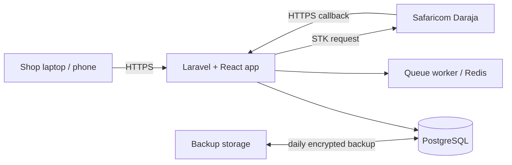

# 05 — Build plan, stack, timeline and launch

## Recommended stack

**Responsive web app / PWA:** Laravel (PHP) modular monolith + Inertia/React + TypeScript + Tailwind CSS + PostgreSQL. Laravel handles authentication, permissions, database transactions, scheduled jobs and queues. React gives fast forms for the shop counter. PostgreSQL enforces unique IDs, stock integrity and reporting. Use Redis for background jobs and short-lived state. Host the app on a managed VPS/cloud service with HTTPS, automated database backups and monitoring. Use a server-side Daraja adapter for M-Pesa Express and C2B; never call Daraja from the browser.

Why this shape: one deployable application and one source of truth are easier to maintain for a growing shop than separate microservices or a desktop-only app. A browser app works on a shop laptop and phones, while server transactions keep inventory consistent. If the developer is much stronger in another stack, the same data model and workflow matter more than the framework choice; a TypeScript/Next.js + PostgreSQL stack can also work if its queue, webhook and transaction handling are designed carefully.

## Deployment layout

Use separate staging and production settings. Keep keys in server secrets, restrict administrator access, enable two-factor authentication for owner/admin if possible, test restore from backup, and record errors without logging customer PINs or API secrets.

## Realistic schedule

Assumes **one experienced full-time developer**, one owner who can review weekly, one shop location, and a functioning Paybill for production M-Pesa testing. Calendar time can increase if catalogue cleanup or Safaricom onboarding is slow.

| Phase | Time | Deliverable |
|---|---:|---|
| Discovery and stock audit | Week 1 | Confirm product names, units, order rules, sample receipts, 10–20 real products and current roll counts |
| UX and foundation | Weeks 2–3 | Approved screens, individual login/roles, fabric type/texture/colour catalogue, database, import templates |
| Inventory and production | Weeks 4–6 | Receive rolls, ledger, reservations, cut/sew jobs, finished stock, stocktake |
| Sales and reports | Weeks 7–8 | Custom orders, POS, receipts, basic reports and exports |
| M-Pesa and reconciliation | Weeks 9–10 | Sandbox STK/C2B, callbacks, unmatched queue, production readiness |
| Pilot and launch | Weeks 11–12 | Real data migration, training, parallel check against manual book, fixes and go-live |

**First usable stock/sales pilot:** about 6–8 weeks if scope stays tight. **Production-ready system with M-Pesa and reconciliation:** about 10–12 weeks. A solo developer working part time should plan around 4–6 months. Extra branches, full offline operation, ecommerce, complex costing or accounting integration add scope. M-Pesa go-live depends on the business having an eligible live Paybill/Till and Safaricom approval; [Safaricom's M-PESA Express page](https://developer.safaricom.co.ke/apis/MpesaExpressSimulate) lists live shortcode and admin/manager operator as prerequisites.

## Build order and acceptance checks

1. **Audit current practice.** Watch one roll receipt, cut, sewing job, sale, deposit and end-of-day close. Capture the paper forms and agreed vocabulary.
2. **Import clean starting balances.** Create catalogue and tag each physical roll. Owner signs off opening metres and finished quantities.
3. **Prove the ledger.** A 50 m roll cut by 8 m must show 42 m physical, with offcuts/waste reconciled. Test a set with shia, one curtain piece without shia, shia alone, and a direct metre sale; each deducts only its selected material/output once.
4. **Prove staff attribution and counter flow.** Two staff logins record separate sewing jobs; a 20 m staff total opens to the underlying accepted jobs and excludes reversed entries. Two cashiers cannot sell the same final stock; a return leaves a trace; receipt balances match payments.
5. **Prove M-Pesa failure paths.** Success, cancellation, timeout, delayed/duplicate callback, wrong amount and manual Paybill with missing reference all have a safe status. No duplicate payment is posted.
6. **Pilot for at least one full stock-and-sales cycle.** Compare system roll counts, orders and payment totals with physical stock and M-Pesa portal statement daily; resolve discrepancies before retiring the book.

## First costs to budget for

Hosting/domain/backups, a small printer and roll labels if desired, staff training, implementation time, and any Safaricom/business Paybill setup or transaction terms. Do not quote payment fees or hosting prices from this draft; request current commercial terms when choosing providers.
