# 07 — Make the pilot work like a curtain shop

Prepared 21 October 2026. This is a product correction to the local pilot, not a claim that the planned features already work. Vendor pages below describe their own products; they are reference points, not an endorsement or a verified account of Trendy Collections' practice.

## What the comparison showed

Purpose-built systems carry one measured job from quote to order to workroom sheet and fitting. They retain rooms, openings, dimensions, fabric and style choices, and price rules, then reuse those details in production. InterioApp describes room/window treatment quotes and work orders; Solatech describes yardage and labour pricing followed by production; BUZ describes a confirmed quote becoming a job with its specifications intact. [InterioApp quoting](https://interioapp.com/quoting-system) · [Solatech workroom](https://www.solatech.com/workroom-software) · [BUZ made-to-measure](https://www.buzsoftware.com.au/made-to-measure-software/)

The maker's side is equally specific: work orders, cut sheets, stages, labels, and checks. Pattern repeat, heading and hem allowances, fabric width and panel count affect cut planning, so a generic “metres used” entry cannot substitute for a job specification. [Solatech fabrication](https://solatech.com/solatech-fabrication) · [Workroom Tech yardage example](https://www.workroomtech.com/post/30-minutes-with-workroom-tech---episode-41-calculating-yardage)

## Why the current app feels superficial

The pilot currently starts at **fabric**, **roll**, or **production job**. A job has one customer name, one room text field, one output type and optional dimensions. It has no customer order containing several windows or mixed items. Cuts are tied to a job, but there is no approved specification or cut plan to compare them against. Finishing posts stock, and a separate one-line sale can consume it; the sale is not tied back to the customer's order. The cash/unpaid flag is not a payment history. The dashboard therefore counts records but cannot show what is due, blocked, ready for collection, or awaiting a balance.

This is a useful inventory proof, but it is not yet a credible daily work system for a made-to-measure curtain business. The existing mockup shows some of these concepts visually, while the running app does not implement them.

## The transaction that should drive the system

```mermaid
flowchart LR
  A[Enquiry] --> B[Customer and rooms]
  B --> C[Opening measurements and choices]
  C --> D[Quote revision]
  D --> E[Customer approval]
  E --> F[Order and deposit]
  F --> G[Reserve rolls]
  G --> H[Workroom job card and cut plan]
  H --> I[Cut, sew, inspect]
  I --> J[Ready for collection]
  J --> K[Final payment and handover]
```

A walk-in sale of fabric by the metre can enter through a separate fast counter flow. It still gets a proper sale line, stock movement and payment record. Do not force a measurement workflow on that sale.

## One realistic order example

This is a **fictional test case**, not Trendy Collections' approved cutting formula.

- Customer has a living room window and a bedroom window. Each has its own width, drop and notes about measurement source.
- Living room: one curtain set with two curtain pieces and optional shia; chosen curtain and shia fabrics come from different rolls. Bedroom: one single curtain piece without shia.
- The quote has three priced lines, with material, making charge and any fitting or delivery charge shown separately. A saved revision records what the customer agreed to.
- Confirmation sets a due date and reserves the planned metres on named rolls. Physical metres remain unchanged until cutting.
- A printed or on-screen workroom card shows the opening, finished dimensions, piece count, heading, fullness, lining, chosen rolls, planned cut lengths and special instructions. The cutter records actual cuts and offcuts. The tailor records the pieces made. A checker accepts or rejects each output.
- The order can be partly ready. The living room set cannot appear as saleable if its selected shia is unfinished. The bedroom piece can be ready independently.
- A deposit and final payment are separate events. The customer collection screen shows items handed over and the remaining balance.

## Screen structure

The main navigation should lead with **Orders**, **Workroom**, **Stock**, **Counter sales**, **Payments**, and **Reports**. Catalogue and staff settings are secondary.

| Screen | What staff need to see and do |
|---|---|
| Order board | Reference, customer, due date, stage, payment balance, number of openings, and exceptions; filters for due today, awaiting approval, cutting, sewing, quality check, ready and overdue. |
| Order workspace | A persistent header with customer, status, due date, quote total and paid/balance; tabs or sections for openings, quote, materials, production, payments and activity. One action advances the order only when its requirements are met. |
| Opening editor | Room/window label; measured width and drop; measurement source; set/piece/shia/case choices; piece count; fabric and colour; heading/style; fullness; lining; notes. Units beside every field. |
| Quote | Itemised customer view and detailed internal costing. Revisions and approval status. Pricing rules must be configured from the shop's actual practice before automatic estimates are trusted. |
| Workroom board | Jobs grouped by cutting, sewing, inspection and ready; assigned worker, due date, blocked reason and progress. |
| Workroom card | Exact opening specification and material plan, selected roll, calculated and approved cut quantities, actual cuts, offcuts/waste, sewing entries, inspector sign-off and rework notes. Printable on A4. |
| Stock detail | Physical roll balance, reserved balance, available balance, linked orders, chronological movements, remnants and corrections. |
| Collection | Finished items by order line, what is being handed over, payment balance and a receipt or handover record. |

The running app's current top-level “Fabrics → Rolls → Production → Sales” path should become the supporting data behind this order workspace. The visual design should emphasize a job's current stage and next action, with its specifications visible beside the action. Adding more dashboard cards will not solve the missing workflow.

## Data changes needed before the next feature pass

1. `customers`: contact and optional site details, with care for personal data.
2. `orders`: customer, reference, due date, stage, approval, pricing snapshot and collection status.
3. `openings`: one row per room/window with measured and agreed dimensions and measurement source.
4. `order_lines`: set, single piece, shia, case, fabric metres or service; quantity, selected options, price and the opening if applicable.
5. `line_components`: selected fabric and other materials per line, including optional shia and piece count. This prevents a “set” from hiding its actual contents.
6. `quote_revisions`: immutable price and specification snapshot plus approval history. Do not rewrite an accepted quote in place.
7. `stock_reservations`: order line, roll and planned length. Available to promise = physical balance minus active reservations.
8. `production_steps` / `quality_checks`: work assigned, actual worker, accepted output, rejected/rework quantity and reason.
9. `payments` and `handovers`: separate confirmed money movements and collected quantities. M-Pesa integration can follow after this ledger exists.

Existing pilot `jobs`, `cuts`, `sewing_entries`, `finished_stock` and `sales` should be preserved and linked to new order lines where possible. Old standalone records can remain labelled as legacy records; do not invent missing measurements or approvals during migration.

## Build order and acceptance proof

**First vertical slice — implemented in the local pilot:** create a customer order with two openings and mixed items; record manual prices; review and confirm it; generate a printable workroom card from the same saved data. Draft opening measurements can be edited; confirmation locks the specification. This slice does not guess the shop's cut formula. Quote revisions and post-confirmation amendments still need a designed workflow.

**Second:** reserve selected rolls, show physical/reserved/available separately, and block over-allocation. The approved workroom plan then controls actual cutting.

**Third:** production stages, inspection, partial readiness and handover tied to each order line.

**Fourth:** deposits, balances, receipts and daily close. Integrate Daraja only after payment records and reconciliation rules are reliable.

An acceptance walkthrough must demonstrate that changing a bedroom dimension in a draft updates that opening only; confirming an order freezes the approved revision; the workroom card shows the exact chosen fabrics and piece counts; no roll is deducted at reservation; one cut deducts once; a partly completed order remains partly ready; and final collection shows the correct balance.

## Shop decisions needed for accurate automation

Use a real recent job card or paper order with customer details hidden. Confirm: how a set is counted, how shia is sold and sewn, the exact measurement and allowance rules, heading/style options, who approves cutting, how making charges are set, and when a deposit commits stock. Until these are known, staff should enter an approved planned cut and price manually; the system should record the assumptions rather than present an unverified automatic calculation as fact.
